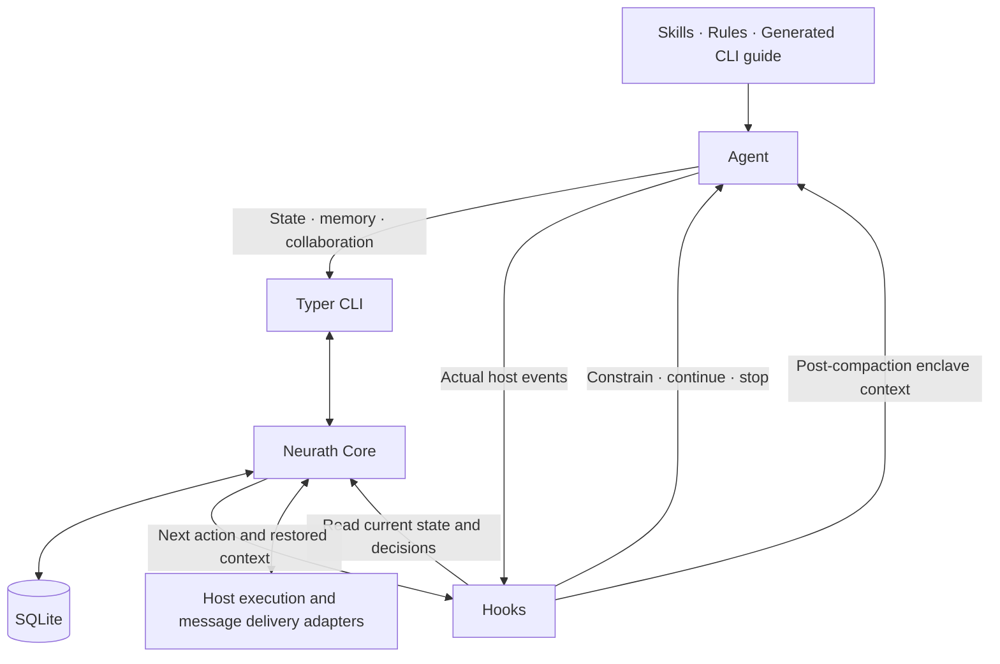

# Neurath complete execution architecture

[Specification](specification.md) · [Capability map](capability-continuity.md) · [Acceptance](acceptance.md) · [한국어](../ko/architecture.md)

**Design status.** Compose execution, memory and collaboration capabilities within one local harness. Separate domain responsibilities without a process, service or approval ledger for every capability.

The [specification](specification.md#core-request-processing-model) defines request processing, storage and project identity. This page describes how that state connects to execution, hooks and collaboration.

## 1. End-to-end flow



All components refer to the same tasks and executions. Delegate outcome and retrospective evaluation through existing collaboration paths.

## 2. Requests, tasks, and TODO

Obtain originals through host input or authorized handoff, then let the executor define work. Retain sources and corrections, required outcomes, projects, assignments, and dependencies. Apply later user corrections only to affected work. Do not turn status questions into new goals. Generate TODO from task reads and mutation results.

Outcomes reference actual artifacts, command results, reviews and targets. A terminal state alone does not establish fulfillment of user intent. A third-party reviewer compares original/current instructions, the full TODO list and actual results, then reports gaps for the executor to incorporate into the same task list.

Apply the [request-attribution rules](specification.md#3-requests-and-outcomes) to assignments and corrections.

## 3. Skills and Phase runner contract

Rules guide agents in selecting a skill for the request. After the agent starts it through CLI, WorkflowRunner manages the run, phases, attempts and outcomes. Distinguish prompt guidance for selection from core management of execution state.

A skill defines a procedure; the runner manages one execution of that definition. Supply project document/check bindings as inputs. Selecting a skill does not authorize external publication or broader permissions.

| Operation | Inputs and checks | Durable result and next action |
| --- | --- | --- |
| Start | Selected definition version, related tasks, required inputs | Run referencing the fixed definition and first ready phase |
| Read current phase | Run and current revision | Inputs, work, outcome conditions, remaining phases |
| Connect execution | Current phase, assignment or host action | Retained attempt and actual execution/delegation; release DB lock first |
| Apply result | Actual attempt result, artifacts, required assessment | Success/failure/waiting and reason; no advance past required unverified work |
| Retry or branch | Failure cause or actual user correction, current state | Retain previous attempt, redo/change affected work only; inspect completed external effects first |
| Handoff/resume | Stored run/tasks/enclave, verified target execution | Reconcile actual execution state and continue remaining phases |
| Finalize | Remaining procedure requirements and results | Apply run outcome to tasks; run termination is not user-goal success |

Phases record `pending → running → succeeded/failed/waiting/skipped`. Runs retain current phase and attempt history. A user-driven definition change preserves old definitions/results. Reconcile a waiting attempt when its existing outcome becomes known; create another attempt only for an actual re-execution. Skipping requires a definition's optional condition or actual scope change; it cannot erase required work.

Actual executors provide mechanical results; selected reviewers provide semantic assessments when needed. Move the old `phase_evidence_prepare` evidence binding inside the runner. Public `report-result` receives actual attempt outcomes and checks conditions; internal transitions retain phase completion/run finalization responsibilities without duplicate termination.

Host tools execute commands; collaboration/provider adapters execute independent work. Recording an execution request is not execution. Record actual interruption/timeouts and inspect stored results/host state after response loss. Response loss alone does not justify repeating a mutation.

Ordinary tasks need not use a runner, but selected skill procedures must actually finish.

Bind results to run, definition version, phase, attempt, and execution target. Advance only when the active attempt and its applicable instruction scope match. If another part of the request changed, establish that this result is unaffected and retain it. Retain late successes, duplicates, and results preceding scope changes as history without automatically passing the current phase. Reassess reusable artifacts against current conditions.

An uncertain external outcome leaves its attempt `waiting` with an explicit reason. Reconcile by actual read-back or externally guaranteed deduplication of the same request. With neither available, do not automatically repeat a mutation. Continue independent work and tell the user what remains unknown if no observation route exists. Do not invent success/failure or promise exactly-once execution in an external system.

Place third-party outcome evaluation in a phase of the skill that completes the user-requested body of work. Run it after gathering implementation/check results and before the completion report, not for each TODO, intermediate reply or status update. Manage it in the run responsible for that body of work; nested or finish skills reuse the same valid evaluation instead of repeating it. Confirmed gaps return execution to the relevant work phase, followed by evaluation of changed results. The associated task remains incomplete until the evaluation phase finishes; Stop deterministically checks task state only. Add no evaluation-only task or separate approval ledger. Do not recursively apply the same evaluation phase to reviewer assignments.

## 4. Runtime, writer ownership, and Stop

Host connections establish actual sessions, turns, child relationships, and environments. Identity is distinct from host permission. Distinguish new sessions, resume, forks, native children, and independent provider roots. Reading/diagnosis needs no writer claim. Coordinate actual shared-checkout writes using current owner and generation.

Stop checks the target execution, current instruction revision, work state, and relevant execution events as one completion candidate. Reject normal completion with actionable work remaining and identify that work. Outstanding required phases belong to the related task's unfinished work. Stale TODO or a separate checkpoint is not another completion vote.

Input waiting, user interruption, and fault-related pauses are distinct from completion. Repeated-Stop flags cannot turn unfinished work into success. A faulty hook also must not generate endless model turns: supported interruption/recovery or official bypass breaks that loop and reports cause/remaining work. Ordinary disconnection retains resumable sessions and enclave.

Recover ownership after executor termination/loss through a use case checking actual liveness and stored state. Retain historical claims as provenance, recording current responsibility and transfer. A `legacy-unknown` label must not create permanent inability to resume.

The Stop hook deterministically checks that every task in the current list is complete. Delegate intent-fulfillment evaluation to a separate subagent or another provider using originals, corrections, TODO, artifacts and verification evidence. Incorporate confirmed gaps into the same list. Bind evaluation to actual results and relevant instructions; reassess affected results when they change. Do not repeat a valid evaluation on every Stop.

| Observed condition | Outcome and next action |
| --- | --- |
| Actual user interruption/cancellation | Request interruption immediately and confirm its outcome; never automatically resume cancelled work |
| Control fault or missing required data | Report pause and unfinished work; recheck after repair or data recovery |
| Only confirmed external dependencies remain | Retain dependency, evidence, and release event; return control and reassess upon that event changing |
| Actionable unfinished work remains | Continue a concrete next action; report and recover a hook fault if only the same rejection repeats |
| Every task in the current session is complete | Normal completion; do not report unverified items as successes |

Evaluate top to bottom; if external waits coexist with independent actionable work, do the latter. An executor's claim of needing input is insufficient: inspect existing instructions, host outcomes, and available authority, then report only the actual missing input. Failed or pending third-party evaluation remains unverified without repeated executor calls.

If a final response has already escaped or missing data arrives later, correct the completion report and restore unfinished work under the same request. Recheck current cancellation and execution state before any resumption. Never claim an emitted response or external effect was undone. Third-party evaluation is not an infallible semantic judgment.

## 5. Enclave, memory, Graphify, and pull

Enclave stores current facts; memory stores attributed history. Facts have keys, values, evidence references, and revisions, rejecting stale updates. Agents assigned to the work can retrieve current facts and originals. Reference larger originals instead of silently truncating important user constraints.

At compaction/resumption/handoff, provide current goals, corrections, task/runner state, and relevant facts, with source retrieval. Goal reminders restore context; they do not change goals or create work. Compare older recollection with current user corrections and source state.

Checkpoints retain work, decisions, and next actions. Do not require fake tasks merely to save a report or equate checkpoint completion with task completion. The `memory_pull` capability provides discovery, preview, selective detail, and adoption. Adoption checks that the previous execution stopped, links work/runner/facts/writer responsibility, and fences duplicate writes by the former executor.

Retain Graphify retrieval and updates of code/document relationships. Rebuilding while losing original document relations is not success. Preserve sources, relations, and verification. The graph does not replace user originals or current enclave.

**Separate enclave writes from context restoration.** Agents call `neurath update-enclave` to persist/update working facts, hypotheses, decisions and evidence in the core. Skills/rules and the generated CLI guide explain this use. A conversational statement alone does not imply persistence.

After compaction, do not wait for the agent to remember a read. The post-compaction hook reads the current session/task enclave from the core and automatically supplies it through a supported context output before the next model request. Keep `neurath get-context` for explicit inspection. No new public restoration command or skill is needed.

```text
Agent → update-enclave CLI → core SQLite state
Compaction completes → post-compaction hook → latest enclave read → model context → continue work
```

The hook does not infer new facts from the compaction summary and overwrite originals. Render bounded current facts/hypotheses/evidence for the relevant session/task. Do not restore corrected/deleted historical facts or mix another task's enclave. Startup/resume may reuse restoration, but manual invocation never substitutes for automatic post-compaction loading.

“Post-compaction hook” denotes the logical context-restoration boundary after compaction. Map it to current official host contracts using `SessionStart` + `compact` with `additionalContext` in Codex and Claude Code. An event named `PostCompact`, or stdout alone, does not prove context delivery. Keep native mapping in adapters and verify delivery to the actual next model input after both auto/manual compaction. [Codex hooks](https://learn.chatgpt.com/docs/hooks), [Claude Code hooks](https://code.claude.com/docs/en/hooks#sessionstart).

An empty enclave is normal and triggers no unnecessary work. Record read/injection failures as actual faults without fabricating restoration or generating endless model turns. Existing fault/wait rules govern genuinely missing information needed for current work.

## 6. Collaboration, Newsroom, and providers

Discover peers and send questions/assignments to actual addresses. Persist messages/delivery intent, then deliver outside transactions. Deduplicate by original message identity. Distinguish persistence, host submission, full reading, ACK, acceptance, and results. Retain subscriptions/publication, conversation read/close, delivery diagnosis/redrive. Reconnection cannot regress a newer ACK or result.

Assignments link original user requests and delegated scope. Recipients need not manufacture human input in their own chat. Their user restrictions still apply; within assigned scope they can execute, check, and report. Independent reviews identify actual candidate/revision/evidence and are incorporated into the original work. Receipt, acceptance, and publication of review are distinct.

Newsroom stores project findings and discussion: articles/headlines/authors/evidence/revisions/comments/seen state. Notify active peers with headlines only; they selectively retrieve bodies. Corrections inform work that relied on the finding. Articles or peer consensus are not task-success evidence. Do not wake inactive peers or replay an inactive-period backlog automatically.

Providers support model/capability discovery, plans with settings, run/status/cancel/recover, and result delivery. Distinguish inherited execution policy from explicitly selected target settings without silent substitution. Native children and independent roots cannot impersonate one another. Before actual execution is observed, report prepared or accepted only.

Requests from the same local user share one SQLite database; linked worktrees share project identity while sessions remain distinct. Cross-project collaboration explicitly connects needed targets/materials; identical remotes do not automatically share independent clones, computers, or private data.

Link delegation to original-request and assignment-scope revisions. On an actual correction/cancellation, the parent updates queued assignments and affected outcomes, then transmits a revision of the same assignment. Connected recipients incorporate it before subsequent execution and interrupt running work where control exists. Unconfirmed delivery/interruption remains explicitly unconfirmed, with the affected target and residual risk reported. Late old results cannot automatically satisfy current requirements; disconnected external execution cannot be promised immediate cancellation.

For multi-part assignments, change only affected work. Further handoff preserves the original revision/cancellation relationship and scope. Creating a new assignment cannot evade cancellation.

## 7. Retrospective, learning and external monitors

Follow the [retrospective procedure](interfaces.md) for offers, third-party evaluation and improvement. Do not automatically generate lasting lessons or harness changes without a user request.

PR/external monitors detect requested external changes and continue authorized work. Retain status/cancel/recover/notification/handoff without repeatedly calling models for unchanged external waiting.

Distinguish notification creation, submission, failure, and observable delivery. Show actionable pauses with cause, unfinished work, and necessary action once through supported user surfaces/notifications. During DB failure use an available host error surface or local recovery record; if none is writable, delivery remains unconfirmed rather than successful. Persist delivery failure, retry finitely, and expose it in status. Do not assume receipt or human attention, or repeatedly call the executor because notification failed.

## 8. Persistence, use cases, and public connections

| Layer | Responsibilities and main groups |
| --- | --- |
| Domain | Meaning/transitions of task/outcome, workflow run/phase attempt, assignment, current fact, review |
| Application | Work, WorkflowRunner, Runtime, Knowledge, Collaboration, Maintenance use cases |
| Infrastructure | SQLite + SQLAlchemy/Alembic, host event storage, bounded delivery queue |
| Transport | Skill/rules installation, Python + Typer `neurath` CLI, state-based hooks, host input/tool execution/interruption/TODO/notification, installation/recovery |

These groups are not deployment service counts. Implement the core as stateless use cases reading DB state on each hook/CLI request. Do not duplicate relations across completion ledgers. WorkflowRunner links procedures to Work results; Collaboration connects actual external execution and independent evaluation.

Persist requests/tasks, runs/phase attempts, host events/executions, current facts/memory, assignments/messages/articles, reviews/learning, and installation/recovery by responsibility. Keep large originals retrievable through references. Do not hold DB write locks during external execution. Use filtered/paginated reads and read transactions, and atomic revision-checked mutations with their related records.

Connect public operations to these use cases without arbitrary per-call token or approval-object assembly. Adapters supply actual identity and authority. Return results/current state/actionable faults; accepted work is not a successful goal. The [public list](interfaces.md) selects 14 skills/19 CLI commands; the [disposition map](capability-continuity.md) connects historical capabilities to public/internal/host paths.

## 9. Installation, upgrade, recovery, and finish-session

Preserve recoverable data/settings before mapping into the new model. Check omissions and actual resumption of unfinished tasks, runners, enclave, messages, and learning. Report unrecognized formats explicitly. For capabilities already removed in 0.3.1, use earlier retained originals/contracts as mapping inputs without copying historical implementation.

Retain installation plans/apply/reuse/recovery, release discovery/application, and public reporting. Rollback does not erase new records. Change only owned configuration; do not permanently hash-lock whole user settings. Test cached callbacks and active-execution transitions too.

Finish-session reconciles user work, selected runners, actual checks/reviews, authorized Git/releases, documents/graphs, handoff, and ownership cleanup before reporting. Do not finish after writing a checkpoint alone, or demand new user instructions merely to save one. Distinguish installation, publication, activation, and completion.

Before DB cutover, stop and confirm existing writers and scheduled write resumptions for that store. If this cannot be confirmed, retain the old path without cutover. Preserve a consistent DB/WAL snapshot and last processed position, migrate, then switch to exactly one verified writer path. Queue incoming events durably during cutover and apply them afterward with order/deduplication preserved. Reject a returning old writer's obsolete write path and direct it to recovery. A backup hash alone does not prove quiescence.

Rollback uses the same quiescence and first preserves new-version records and pending events. Return through a verified lossless compatibility path only when available. Otherwise stop writes and resume through a compatible repair version rather than discarding new data and activating an old DB. Retain original/new databases, settings, and unfinished work; test actual reads/resumption. This is not a reason to force repeated user selection.

## 10. Trade-offs and implementation verification

| Choice | Reason | Cost or limitation |
| --- | --- | --- |
| One store with focused use cases | Avoid duplicate state/operations | Cross-project delivery still needs actual host validation |
| Separate ledger, phase runner, and enclave | Outcome, procedure, and current facts differ | Turning them into separate completion votes recreates complexity |
| Per-capability replacement mapping | Prevent silent removal | Public names selected in interfaces.md; detailed input shapes validated during implementation |

Actual hook enforcement, independent outcome/retrospective evaluation and migration/resumption outcomes need implementation evidence. Documentation does not establish them.

Record final support for each actual connection used by Codex, Claude and rollout projects. Managed-execution success cannot establish existing desktop support. Validate hook/CLI/collaboration execution and results in the requested environment.

In-flight runs retain their pinned definition/current attempt/remaining outcomes. Removing an old default skill does not complete or cancel its run. On public-interface cutover, cached old calls receive the current replacement or required reconnect clearly once; do not repeat failing old calls. Remove only installer-owned default skills and preserve project/user skills plus existing execution definitions/history.

CLI definitions → release-time guide generation/validation → package CLI and prompt → installer refreshes the managed harness region. Generation is a release task, not a new runtime ledger or resident service. Skills/host shell → CLI → existing use cases/storage.

Determine next-action constraints from relevant current core task/phase/assignment/writer state. Reject operations violating applicable prerequisites or premature termination at the supported host boundary and return the necessary next action; proceed when conditions hold. Existing recovery rules prevent self-lockout of reads/diagnostics/state repair and repeated fault blocking. Prompt guidance alone is not enforcement; hooks create no separate requirement/consent/completion ledger.
