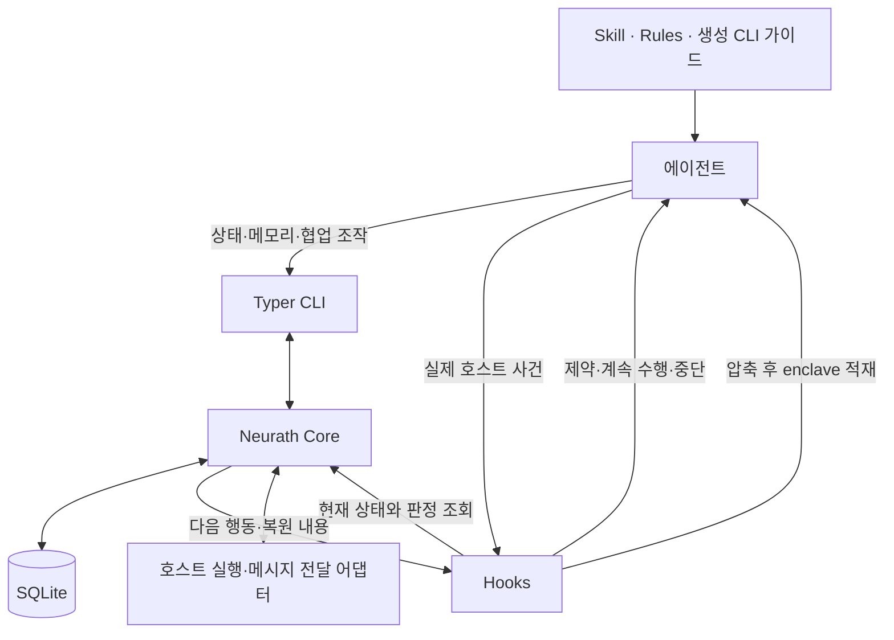

# Neurath 전체 실행 구조

[명세](specification.md) · [기능 대조](capability-continuity.md) · [요구사항 검증](acceptance.md) · [English](../en/architecture.md)

**설계 상태.** 하나의 로컬 하네스 안에 실행·기억·협업 기능을 구성합니다. 도메인 책임을 분리하되 기능마다 프로세스·서비스·승인 원장을 만들지 않습니다.

코어의 요청 처리·저장소·프로젝트 기준은 [명세](specification.md#코어의-요청-처리-모델)에 정의합니다. 이 문서는 그 상태를 실제 실행·훅·협업에 연결하는 흐름을 설명합니다.

## 1. 전체 흐름



그림의 모든 구성은 같은 태스크와 실행을 참조합니다. 결과와 회고의 내용 평가는 기존 협업 경로로 제3자에게 위탁합니다.

## 2. 요청·태스크·TODO

호스트 입력 또는 승인된 인계에서 원문을 확보하고 실행자가 작업을 정의합니다. 원문과 개정 관계, 필요한 결과, 관련 프로젝트, 배정과 의존 관계를 보존합니다. 이후 사용자 정정은 관련 작업만 변경합니다. 상태 질문을 새 목표로 오해하지 않습니다. task 목록과 변경 결과에서 TODO 표시를 같은 상태로 생성합니다.

작업 결과에는 실제 산출물·명령 결과·검토 참조와 적용 대상이 붙습니다. 종료 상태 기록만으로 사용자 의도 충족을 증명하지 않습니다. 제3자 평가자는 사용자 원문·최신 정정·전체 TODO와 결과를 대조하고 미달 항목을 보고합니다. 실행자는 이를 같은 작업 목록에 반영합니다.

배정·교정은 [원문 해석 기준](specification.md#3-요청과-결과)을 따릅니다.

## 3. Skills와 Phase runner의 실행 계약

Rules는 요청에 맞는 스킬 선택을 에이전트에게 안내합니다. 에이전트가 선택한 스킬을 CLI로 시작하면 WorkflowRunner가 run·phase·시도·결과를 관리합니다. 선택을 안내하는 프롬프트와 실행 상태를 관리하는 코어의 책임을 구분합니다.

스킬은 절차 정의이며 runner가 그 정의의 한 실행을 관리합니다. 프로젝트별 문서·검사 바인딩은 스킬 입력으로 전달합니다. 스킬을 선택했다고 외부 공개·권한 확대가 허가되는 것은 아닙니다.

| 동작 | 입력과 확인 | 남는 상태 및 다음 행동 |
| --- | --- | --- |
| 시작 | 선택한 스킬 정의의 버전, 관련 태스크, 필요한 입력 | 고정된 정의를 참조하는 run과 첫 실행 가능 phase |
| 현재 단계 조회 | run과 현재 리비전 | 필요한 입력·수행 작업·결과 조건·남은 단계 |
| 실행 연결 | 현재 phase, 작업 배정 또는 호스트 동작 | attempt를 보존하고 실제 실행/위임; DB 잠금은 실행 전에 종료 |
| 결과 반영 | 실제 attempt 결과, 산출물, 필요한 평가 | 완료·실패·대기와 이유. 결과 확인 전 다음 필수 단계로 진행하지 않음 |
| 재시도·분기 | 실패 원인 또는 실제 사용자 정정, 현재 상태 | 이전 시도 보존, 필요한 단계만 재실행/변경. 성공했던 외부 동작은 먼저 재조회 |
| 인계·재개 | 저장된 run·태스크·enclave, 확인한 대상 실행 | 실제 실행 상태를 맞춘 뒤 남은 phase 계속 |
| 종결 | 선택한 절차의 남은 단계와 결과 | run 결과를 태스크에 반영. run 종결을 사용자 목표 성공과 혼동하지 않음 |

Phase는 `pending → running → succeeded/failed/waiting/skipped`로 기록합니다. run은 현재 단계와 시도 이력을 가지며 사용자 정정으로 정의를 바꿀 때 이전 정의·결과를 보존합니다. 대기 중 기존 시도의 결과가 확인되면 그 attempt를 조정합니다. 실제 재실행이 필요한 재시도만 새 attempt로 연결합니다. 건너뛰기는 원래 정의의 선택 조건 또는 실제 범위 변경에 근거해야 하며 필수 작업을 소거하는 수단이 아닙니다.

기계적 결과는 실제 실행기가, 의미 평가가 필요한 결과는 선택한 리뷰·평가 담당자가 제공합니다. 과거 `phase_evidence_prepare`의 근거 연결은 내부 처리로 옮깁니다. 새 공개 `report-result`가 실제 시도 결과를 받아 조건을 대조하고, 기존 단계 완료와 run 종결의 책임은 내부 전이에서 중복 없이 반영합니다.

명령 실행은 호스트 도구, 독립 작업은 collaboration/provider 어댑터로 연결합니다. runner가 “실행 요청 기록”만 쓰고 실행했다고 보고해서는 안 됩니다. 인터럽트·타임아웃은 실제 결과에 남고, 응답 유실 시 저장 결과와 호스트를 조회합니다. 응답 유실만으로 변경 동작을 재전송하지 않습니다.

일반 task에는 runner를 강제하지 않지만 선택한 스킬의 절차는 끝까지 수행합니다.

결과는 run·정의 버전·phase·attempt·실행 대상과 연결합니다. 현재 시도와 그 시도에 적용되는 요청 범위가 일치할 때만 진행에 반영합니다. 요청의 다른 부분만 바뀌었다면 영향 없음을 대조하고 유효한 결과를 유지합니다. 이전 시도의 늦은 성공, 중복 응답, 범위 변경 전 결과는 이력으로 보존하며 현재 단계를 자동 통과시키지 않습니다. 재사용 가능한 산출물은 현재 조건으로 다시 평가합니다.

외부 동작의 결과를 알 수 없으면 해당 attempt를 `waiting`으로 두고 결과 불명 이유를 기록합니다. 먼저 실제 결과 조회 또는 외부 시스템이 보장하는 동일 요청 중복 제거를 사용합니다. 둘 다 없는 변경 동작은 자동 재실행하지 않습니다. 독립적인 남은 일은 계속하고, 확인 가능한 경로가 없으면 무엇이 불명인지 사용자에게 알립니다. 실패나 성공으로 꾸미지 않으며 외부 시스템까지 정확히 한 번 실행된다는 보장은 하지 않습니다.

사용자가 요청한 작업 묶음을 마무리하는 스킬에 제3자 결과 평가 phase를 둡니다. 해당 phase는 구현·검사 결과를 모아 완료 보고 전에 실행하며, 개별 TODO나 중간 답변·상태 보고마다 평가자를 호출하지 않습니다. 같은 작업 묶음을 담당하는 run에서 평가를 관리하고, 하위 스킬이나 마무리 스킬이 동일한 유효 평가를 중복 실행하지 않습니다. 미달 항목이 확인되면 관련 수행 단계로 돌아가 보완한 뒤 변경된 결과를 재평가합니다. 평가 phase가 끝나기 전에는 연결된 태스크가 완료되지 않으며, Stop 훅은 태스크 상태만 결정론적으로 확인합니다. 평가 전용 태스크나 별도 승인 원장을 추가하지 않습니다. 평가 자체를 맡은 작업에 같은 평가 phase를 재귀적으로 적용하지 않습니다.

## 4. Runtime·작성 소유권·Stop

호스트 연결은 실제 세션·턴·자식 관계·실행 환경을 식별합니다. 식별자가 있다는 것과 호스트 권한이 있다는 것은 다릅니다. 새 세션, 재개, 포크, 네이티브 자식, 독립 provider 루트를 구분합니다. 읽기·진단은 작성 claim 없이 가능합니다. 공유 체크아웃의 작성 충돌만 현재 소유자와 세대로 조정합니다.

Stop은 대상 실행과 현재 사용자 요청 개정·작업 상태·관련 실행 사건을 같은 종료 후보로 검사합니다. 미완료 수행이 남은 정상 종료는 거절하며 어떤 작업을 계속할지 반환합니다. 선택한 절차에서 아직 수행하지 않은 필수 phase는 그 태스크의 미완료 상태에 반영됩니다. 오래된 TODO나 별도 체크포인트가 추가 종료 투표를 행사하지 않습니다.

입력 대기·사용자 중단·장애로 인한 일시 중지는 작업 완료와 별개로 기록합니다. Stop 반복 플래그만으로 미완료 일을 성공시킬 수 없습니다. 동시에 훅 장애가 같은 모델 턴을 무한 생성하도록 두지 않습니다. 지원되는 중단·복구 또는 공식 우회로 해당 루프를 끊고 원인·남은 작업을 알립니다. 정상 연결 종료는 재개 가능한 세션과 enclave를 보존합니다.

종료·유실된 작성자 회수는 실제 liveness와 저장 상태를 확인하는 복구 유스케이스로 처리합니다. 과거 claim을 그대로 현재 권한으로 쓰지 않고, 현재 담당자와 이전 관계를 기록합니다. `legacy-unknown`이라는 이름만으로 영구 재개 불가 상태를 만들지 않습니다.

종료 훅은 최신 태스크 목록의 모든 작업이 완료됐는지 결정론적으로 확인합니다. 사용자 의도 충족 여부는 서브에이전트 또는 다른 provider의 독립 평가로 확인합니다. 평가에 필요한 원문·정정·TODO·산출물·검증 근거를 제공하고, 확인된 미달 항목은 같은 목록에 반영합니다. 평가는 실제 결과와 관련 요청 개정에 연결하고, 해당 내용이 바뀌면 영향받은 평가만 갱신합니다. 동일한 유효 평가를 Stop마다 다시 호출하지 않습니다.

| 관찰된 상황 | 반환하는 결과와 다음 행동 |
| --- | --- |
| 실제 사용자 중단·취소 | 즉시 중단을 요청하고 실제 중단 여부를 확인. 취소된 일을 자동 재개하지 않음 |
| 제어 장애·필요 자료 유실 | 일시 중지와 미완료를 알림. 장애가 고쳐지거나 자료가 복구될 때 재확인 |
| 확인된 외부 의존만 남음 | 대기 대상·확인 근거·해소 사건을 보존하고 제어권 반환. 해당 사건 변경 때 재평가 |
| 실행 가능한 미완료 일이 있음 | 구체적인 다음 일을 이어감. 같은 거절만 반복되면 훅 장애로 보고하고 복구 |
| 현재 세션의 모든 태스크가 완료됨 | 정상 완료. 확인되지 않은 항목을 성공이라고 보고하지 않음 |

판정 순서는 위에서 아래이며 외부 대기와 독립 실행 가능한 일이 함께 있으면 후자를 진행합니다. 실행자의 “사용자 입력 필요” 주장만으로 대기를 확정하지 않습니다. 기존 지시·호스트 결과·실제 권한으로 해결 가능한지 확인하고, 실제 필요한 입력만 구체적으로 알립니다. 제3자 평가의 실패·대기는 검증 미완료로 보존하고 같은 실행을 반복 호출하지 않습니다.

호스트가 최종 응답을 이미 내보냈거나 자료 누락이 뒤늦게 발견되면 완료 보고를 정정하고 같은 요청의 미완료를 복원합니다. 현재 사용자 취소와 실행 상태를 다시 확인한 뒤 필요한 경우에만 재개합니다. 이미 표시된 응답이나 외부 효과를 취소했다고 주장하지 않습니다. 제3자 평가도 내용 판단의 무오류 보장은 아닙니다.

## 5. Enclave·기억·Graphify·pull

Enclave에는 현재 사실을 담고, 기억에는 출처가 있는 이력을 담습니다. 사실은 키·값·근거 참조·리비전으로 표현하고 예전 리비전의 변경을 거절합니다. 관련 작업의 에이전트는 최신 사실과 원문을 조회할 수 있습니다. 크기를 넘는 상세 내용은 원문 참조로 남기며 중요한 사용자 제한을 조용히 잘라내지 않습니다.

압축·재개·전환 때는 현재 목표, 정정, 작업과 runner 상태, 관련 사실을 제공하고 필요한 원문을 조회합니다. 목표 알림은 맥락 복원이며 사용자 목표 변경이나 새 작업 생성이 아닙니다. 오래된 회상은 현재 사용자 정정과 실제 소스에 대조합니다.

체크포인트는 작업·결정·다음 행동을 보존하는 보고입니다. 보고를 남기기 위해 가짜 task를 만들게 하지 않으며 보고 완료를 태스크 완료와 혼동하지 않습니다. `memory_pull`에 해당하는 흐름은 발견·미리보기·필요한 상세 읽기·인수입니다. 인수는 원래 실행이 중지됐는지 확인한 후 작업·runner·관련 사실과 작성 책임을 연결하고 이전 실행의 중복 작성을 막습니다.

Graphify는 코드와 문서 관계를 탐색하고 갱신하는 역할을 유지합니다. 원래 문서 관계를 잃은 재생성을 성공으로 간주하지 않으며 원문·관계·검사 근거를 보존합니다. 그래프가 사용자 원문이나 현재 enclave를 대신하지는 않습니다.

**Enclave의 쓰기와 컨텍스트 복원은 경로를 분리합니다.** 에이전트는 `neurath update-enclave`를 호출해 작업 중 사실·가설·판단과 근거를 코어에 기록·갱신합니다. Skill/rules와 생성된 CLI 가이드가 이 사용법을 안내합니다. 대화에만 말한 내용을 자동 저장했다고 가정하지 않습니다.

컨텍스트가 압축된 뒤에는 에이전트가 별도 조회를 기억하기를 기다리지 않습니다. 압축 후 훅이 현재 세션·작업에 해당하는 코어의 최신 enclave를 읽고, 호스트가 지원하는 컨텍스트 출력으로 다음 모델 요청 전에 자동 적재합니다. `neurath get-context`는 필요할 때의 명시적 조회 경로로 남습니다. 복원만을 위해 새 공개 CLI 명령이나 스킬을 추가하지 않습니다.

```text
에이전트 → update-enclave CLI → 코어의 SQLite 상태
압축 완료 → 압축 후 훅 → 코어의 최신 enclave 조회 → 모델 컨텍스트 → 작업 계속
```

훅은 압축 요약에서 사실을 다시 추론해 원본을 덮어쓰지 않습니다. 저장된 최신 사실·가설 구분·근거를 짧게 구성하며 현재 세션/작업에 필요한 내용만 전달합니다. 이미 정정·삭제된 옛 사실을 복원하거나 다른 작업의 enclave를 섞지 않습니다. 초기 시작·재개 시 같은 맥락 복원 기능을 재사용할 수 있지만 압축 후 적재를 수동 호출로 대체하지 않습니다.

여기서 “post compaction hook”은 압축이 끝난 뒤 모델 컨텍스트를 보충하는 논리적 접점입니다. 현재 공식 호스트 계약에 맞춰 Codex와 Claude Code의 `SessionStart` + `compact` 경로에서 `additionalContext`를 사용합니다. `PostCompact`라는 이벤트 이름이나 stdout 출력만으로 컨텍스트가 적재된다고 가정하지 않습니다. 호스트별 매핑은 어댑터 안에 두고 자동/수동 압축 뒤 실제 다음 모델 입력으로 전달되는지 검증합니다. [Codex 훅](https://learn.chatgpt.com/docs/hooks), [Claude Code 훅](https://code.claude.com/docs/en/hooks#sessionstart).

빈 enclave는 정상 상태이며 불필요한 동작을 만들지 않습니다. 저장소 조회나 주입 실패는 실제 장애로 기록하고, 복원됐다고 꾸미거나 같은 모델 턴을 무한 생성하지 않습니다. 현재 작업 수행에 필요한 자료가 없을 때의 처리는 기존 장애/대기 규칙을 따릅니다.

## 6. Collaboration·Newsroom·Provider

피어를 발견하고 실제 주소로 질문하거나 작업을 배정합니다. 메시지와 전달 의도를 먼저 보존하고 호스트 전달은 트랜잭션 밖에서 수행합니다. 원래 메시지 ID로 중복을 구분합니다. 저장·호스트 제출·본문 읽기·ACK·수락·실제 결과는 각각 확인합니다. 구독·발행, 대화 조회·종료, 실패 전달 진단·재전송도 유지합니다. 재연결이 늦은 ACK나 새로운 결과를 되돌릴 수 없습니다.

배정에는 원래 사용자 요청과 맡긴 범위가 연결됩니다. 수신자가 다른 채팅의 지시를 인간 발언으로 다시 만들 필요는 없습니다. 수신자의 사용자 제한은 계속 적용되고, 위임받은 범위에서 실행·검사·결과 반환을 할 수 있습니다. 독립 리뷰는 실제 검토한 후보·리비전·근거를 포함하고 원래 작업에 반영합니다. 리뷰의 수신·수용·게시를 구분합니다.

Newsroom은 같은 프로젝트의 발견을 게시·토론합니다. 글·제목·작성자·근거·개정·댓글·열람을 보존하고 활성 피어에게 제목만 알립니다. 관련 본문을 읽은 뒤 필요한 작업에 사용합니다. 정정은 실제 의존한 작업에 영향을 알리며, 기사 존재나 동료 다수의 동의가 작업 성공을 증명하지 않습니다. 비활성 세션을 깨우거나 대기 기간의 기사를 자동 재전송하지 않습니다.

Provider는 모델/기능 조회, 설정을 포함한 실행 계획, 실행·상태·취소·복구와 결과 반환을 제공합니다. 바로 앞 실행자의 정책과 명시된 대상 설정을 구분하며 미지원 상속을 몰래 바꾸지 않습니다. 네이티브 자식과 독립 루트를 서로 사칭하지 않습니다. 실제 실행을 관찰하기 전에는 준비됐거나 접수됐다고만 보고합니다.

프로젝트 내부 워크트리를 포함한 같은 사용자의 요청은 하나의 SQLite를 공유하며 프로젝트·세션은 DB 안에서 구분합니다. 프로젝트 간 협업은 사용자 요청에 필요한 대상·자료만 명시적으로 연결합니다. 같은 원격 주소가 있다고 독립 클론·컴퓨터·비공개 자료를 자동 공유하지 않습니다.

위임에는 원 요청과 배정 범위의 개정을 연결합니다. 부모가 실제 정정·취소를 받으면 대기 배정과 영향받은 결과를 갱신하고 수신자에게 같은 배정의 변경을 전달합니다. 연결된 수신자는 다음 실행 전 최신 배정을 반영하고, 진행 중이면 가능한 제어 경로로 중단합니다. 전달·중단을 확인하지 못하면 취소 완료라고 표시하지 않고 그 대상과 남은 위험을 알립니다. 늦은 옛 결과는 현재 요구를 자동 만족시키지 않습니다. 연결이 끊긴 외부 실행까지 즉시 취소할 수 있다는 보장은 하지 않습니다.

배정 하나에 여러 작업이 있으면 정정된 부분만 바꾸고 나머지는 유지합니다. 수신자가 인계를 다시 해도 원 요청의 개정 관계와 취소가 전파됩니다. 추가 인계는 원래 범위 안에서만 가능하며 취소를 회피하기 위한 새 배정 생성은 허용하지 않습니다.

## 7. 회고·학습·외부 작업 모니터

회고 제안·제3자 평가·개선은 [회고 절차](interfaces.md)에 따릅니다. 사용자의 요청 없이 지속적인 교훈이나 하네스 변경을 자동 생성하지 않습니다.

PR·외부 작업 모니터는 요청된 외부 상태 변화를 확인하고 허용된 후속 작업을 이어갑니다. 상태·취소·복구·알림·인계를 유지하며, 같은 외부 대기 상태에는 모델을 반복 호출하지 않습니다.

알림은 작성·제출·실패·확인 가능한 전달을 구분합니다. 조치가 필요한 중단은 지원되는 사용자 화면과 알림 경로에 원인·남은 일·필요한 조작을 한 번 남깁니다. DB 장애일 때도 가능한 호스트 오류 표시 또는 로컬 복구 기록으로 원인을 남깁니다. 실제로 쓸 수 있는 경로가 하나도 없으면 전달 미확인 상태이며 알림 성공으로 보고하지 않습니다. 전달 실패는 저장하고 유한하게 재시도하며 조회 화면에도 노출합니다. 알림이 성공했거나 사용자가 봤다고 추정하지 않으며, 알림 실패 때문에 실행자를 반복 호출하지 않습니다.

## 8. 저장·유스케이스·공개 연결

| 계층 | 책임과 주요 묶음 |
| --- | --- |
| Domain | task/outcome, workflow run/phase attempt, assignment, current fact, review의 의미와 전이 |
| Application | Work, WorkflowRunner, Runtime, Knowledge, Collaboration, Maintenance 유스케이스 |
| Infrastructure | SQLite + SQLAlchemy 저장, Alembic 이전, 호스트 사건 저장, 제한된 전달 큐 |
| Transport | Skill/rules 설치, Python + Typer 기반 `neurath` CLI, 상태 기반 훅, 호스트 입력·도구 실행·중단·TODO·알림, 설치와 복구 |

이 묶음은 배포 서비스 수가 아닙니다. 코어는 각 hook·CLI 요청에서 DB를 조회하는 stateless 유스케이스로 구성합니다. 같은 관계를 여러 완료 원장에 복제하지 않습니다. WorkflowRunner는 Work와 결과를 연결하고, Collaboration은 실제 외부 실행과 독립 평가를 연결합니다.

저장은 요청/태스크, run/phase attempt, 호스트 사건/실행, 현재 사실/기억, 배정/메시지/기사, 리뷰/학습, 설치/복구 기록을 책임별로 관계화합니다. 큰 원문은 참조로 두되 조회 가능하게 보존합니다. 외부 실행 동안 DB 쓰기 잠금을 유지하지 않습니다. 조회는 필터·페이지와 읽기 트랜잭션을 사용합니다. 변경은 필요한 리비전과 관련 기록을 원자적으로 반영합니다.

공개 명령은 이 유스케이스로 연결합니다. 모든 작업에 임의 토큰이나 별도 승인 객체를 조립하게 하지 않습니다. 필요한 호스트 신원과 실제 권한은 어댑터가 전달합니다. 응답에는 실제 결과·현재 상태·문제가 있으면 해결 가능한 이유를 제공하고, 접수 성공을 목표 성공으로 말하지 않습니다. [공개 목록](interfaces.md)은 스킬 14개·CLI 19개를 정의하며, [기능 배치표](capability-continuity.md)는 옛 기능을 새 공개·내부·호스트 경로에 연결합니다.

## 9. 설치·업그레이드·복구·finish-session

기존 자료와 설정을 복구 가능하게 보존한 뒤 새 모델에 대응시키고, 미완료 작업·runner·enclave·메시지·학습의 누락과 실제 재개를 확인합니다. 인식하지 못한 형식은 불확실성으로 보고합니다. 현재 0.3.1에 이미 사라진 기능은 더 이전에 보존된 원문·계약을 통해 새 구현에 대응합니다. 옛 구현 코드를 본보기로 복제하지 않습니다.

설치 계획·실제 적용·동일 설치 확인·복구·릴리스 조회와 적용·공개 보고의 기능을 유지합니다. 원본과 새 기록을 삭제하는 rollback은 하지 않습니다. 설치기가 소유한 부분만 수정하며 사용자 설정 전체를 영구 해시로 고정하지 않습니다. 호스트에 캐시된 호출과 진행 중 실행의 전환도 시험합니다.

finish-session은 남은 사용자 일, 선택한 runner, 실제 검사·리뷰, 승인된 Git/릴리스, 문서·그래프, 인계와 소유권 정리를 수행하고 결과를 보고합니다. 체크포인트만 만들고 종료하지도, 체크포인트를 쓰려고 새 사용자 지시를 요구하지도 않습니다. 설치·배포·활성화·완료를 구분합니다.

DB 전환 전에 해당 저장소의 기존 작성 실행과 예약된 작성 재개를 멈추고 확인합니다. 그 확인을 할 수 없으면 기존 경로를 유지하고 전환하지 않습니다. 정지 뒤 일관된 DB/WAL 스냅샷과 마지막 처리 위치를 보존해 이전하고, 검증된 한 작성 경로로만 연결을 바꿉니다. 전환 중 새 사건은 보존된 큐에 쌓아 전환 후 같은 순서와 중복 구분으로 반영합니다. 옛 작성 경로가 다시 접속하면 구버전 쓰기를 거절하고 복구 경로로 안내합니다. 단순 백업 해시 확인을 작성 정지의 증명으로 쓰지 않습니다.

Rollback도 같은 작성 정지를 적용하고 새 버전에서 생긴 기록과 미처리 사건을 먼저 보존합니다. 구버전이 이해하는 자료만 손실 없이 반영할 수 있는 검증된 경로가 있으면 그 경로로 복귀합니다. 그렇지 않으면 새 자료를 버리고 예전 DB를 활성화하지 않고, 쓰기를 멈춘 채 호환 가능한 복구 버전으로 재개합니다. 원본·새 DB·설정·미완료 일을 모두 유지하고 실제 읽기/재개를 시험합니다. 이는 사용자에게 선택 입력을 다시 강요하는 이유가 아닙니다.

## 10. 선택의 이유와 남은 구현 검증

| 선택 | 이유 | 부담 또는 한계 |
| --- | --- | --- |
| 하나의 저장소와 유스케이스 | 중복 상태·운영 복잡도 감소 | 프로젝트 간 전달은 실제 호스트 연결로 따로 검증 |
| 원장 + phase runner + enclave 구분 | 결과·절차·현재 사실의 역할이 다름 | 서로 다른 완료 투표로 만들면 다시 복잡해짐 |
| 기능별 호환 대응 | 재작성 중 조용한 삭제 방지 | 공개 이름은 interfaces.md에서 선별; 세부 입력 형식은 구현에서 검증 |

실제 훅 집행, 독립 결과·회고 평가, 데이터 이전·재개 결과는 구현에서 확인합니다. 문서가 있다는 이유로 해결됐다고 표시하지 않습니다.

최종 지원 판정은 Codex·Claude와 업데이트 대상 프로젝트의 실제 사용 연결별로 남깁니다. 관리 실행의 성공을 기존 데스크톱 연결의 성공으로 대신하지 않습니다. 요청된 환경의 훅·CLI·협업 실행과 결과를 실제로 검증합니다.

기존 절차를 진행 중인 run은 시작 때 보존한 정의·현재 시도·남은 결과를 유지합니다. 옛 스킬을 기본 목록에서 제외했다고 run을 완료·취소하지 않습니다. 공개 인터페이스 전환 때 캐시된 옛 호출에는 현재 대체 경로 또는 필요한 재연결을 한 번 명확히 알리고, 실패한 옛 호출을 반복 실행하지 않습니다. 기본 설치에서 제거하는 대상은 설치기가 소유한 스킬에 한하며 프로젝트/사용자 스킬과 기존 실행의 정의·기록을 보존합니다.

CLI 명령 정의 → 릴리스 가이드 생성/검증 → CLI와 프롬프트를 함께 패키징 → 설치기의 하네스 관리 영역 갱신으로 이어집니다. 가이드 생성은 릴리스 작업이며 새로운 실행 원장·상주 서비스가 아닙니다. 스킬/호스트 셸 → CLI → 기존 유스케이스/저장 경로를 사용합니다.

훅의 다음 동작 제약은 코어의 현재 관련 작업·phase·배정·작성 상태를 기준으로 판단합니다. 적용되는 선행 조건을 어기는 실행이나 성급한 종료는 해당 호스트 경계에서 거절하고 필요한 다음 행동을 돌려줍니다. 조건을 만족하면 진행합니다. 조회·진단·상태를 고치는 경로까지 막는 자기봉쇄나 훅 장애의 반복 차단은 기존 복구 규칙으로 방지합니다. 프롬프트만으로 강제 집행했다고 표시하거나, 훅이 코어와 별도의 요구·동의·완료 원장을 만들지 않습니다.
